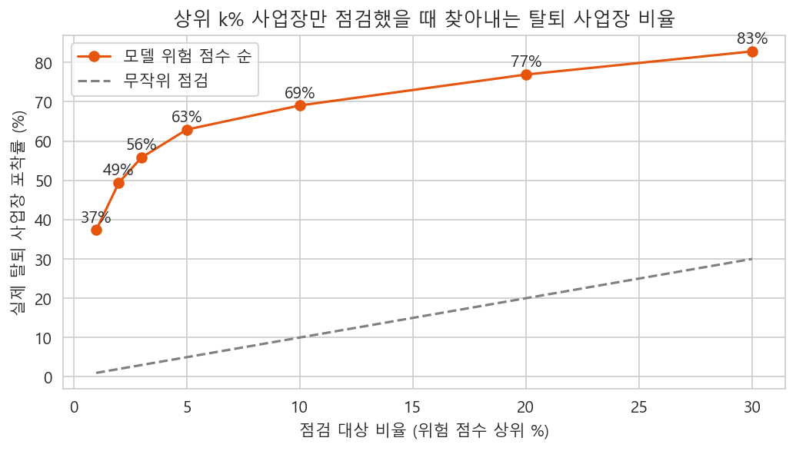

# 국민연금 가입 사업장 데이터로 본 사업장 탈퇴(폐업) 조기 예측

> 데이터분석(2026-2) 기말대체 프로젝트 · 인하공업전문대학 컴퓨터정보공학과 202444085 김철중

**지금 국민연금에 가입되어 있는 사업장 가운데 3개월 안에 탈퇴(폐업·휴업·현장 종료)할 곳을 미리 찾을 수 있을까?**
공공데이터포털의 월별 「국민연금 가입 사업장 내역」 5개월분을 사업장 단위로 연결해 패널 데이터를 만들고,
탈퇴 비율 0.4%의 극단적 불균형 분류 문제를 머신러닝과 오버샘플링(FI-SMOTE)으로 풀었다.

## 핵심 결과

| 항목 | 값 |
|---|---|
| 분석 사업장 | 513,541곳 (기준월 2026-07, 3개월 뒤 2026-10 상태 확인) |
| 3개월 내 탈퇴 | 2,033곳 (**0.40%**) |
| 최종 모델 | RandomForest (GridSearchCV 튜닝) + **FI-SMOTE** |
| 테스트셋 성능 | F1 **0.227** · MCC **0.225** · ROC-AUC 0.861 · PR-AUC 0.169 (무작위 기준선 0.004) |
| 실무 활용 | 위험 점수 **상위 5%** 사업장만 점검해도 실제 탈퇴 사업장의 **62.9%** 포착 (상위 1% → 37.3%) |
| 주요 요인 | 신규진입(최근 3개월 내 등록) · 업력 · 가입자 규모 · 취득률 · 고지금액 증감률 |

- 전부 "유지"라고 찍어도 정확도는 99.6% → 정확도 대신 Precision·Recall·F1·PR-AUC로 평가
- 오버샘플링 3종(SMOTE·ADASYN·FI-SMOTE) 중 FI-SMOTE가 두 모델 모두에서 PR-AUC 최고, RandomForest와 결합 시 F1·MCC 전체 1위
- 탈퇴 사업장의 49%가 건설·공사업(전체 비중은 13.9%) → '탈퇴'에는 폐업뿐 아니라 공사 현장 종료도 섞여 있음



## 폴더 구조

```
NPS-Workplace-Exit-Prediction/
├── nps_exit_prediction.ipynb   # 전체 분석 노트북 (실행 결과 포함)
├── src/
│   ├── download_data.py        # 공공데이터포털에서 월별 CSV 내려받기
│   └── fi_smote.py             # FI-SMOTE 오버샘플링 (본인 1학기 연구 코드 이식)
├── figures/                    # 노트북이 저장한 그래프 (보고서·발표자료에 사용)
├── results/                    # 모델 비교·불균형 처리·임계값·중요도 결과 CSV
├── docs/                       # 최종 보고서(PDF), 발표자료(PDF)
└── data/raw/                   # 원본 CSV (용량 문제로 Git 제외)
```

## 실행 방법

```bash
pip install -r requirements.txt
python src/download_data.py          # data/raw/ 에 5개월분 CSV (약 570MB) 저장
jupyter notebook nps_exit_prediction.ipynb
```

전체 실행 시간은 8코어 PC 기준 약 30분이다 (그리드 서치가 약 18분).

## 분석 흐름

1. **데이터 수집·정제** – 월별 CSV 5개(2026-03·04·06·07·10월분), 사업장 키(사업자번호 앞 6자리+사업장명+법정동코드+업종코드) 중복 제거
2. **병합·라벨링** – 기준월 등록 사업장에 과거 3개 시점 정보를 `merge`, 3개월 뒤 가입상태가 '탈퇴'면 1
3. **파생변수 17개** – 1인당 고지금액, 상실률·취득률, 업력, 1/3/4개월 인원 증감률, 고지금액 증감률, 신규진입 여부 등
4. **EDA** – 클래스 불균형, 규모·업력·업종·지역별 탈퇴율, 박스플롯, 상관계수 히트맵
5. **모델 비교** – 로지스틱 회귀, 결정트리, 랜덤포레스트, AdaBoost, XGBoost, LightGBM, Soft Voting (층화 5-겹 교차검증)
6. **불균형 처리** – 없음 / class_weight / SMOTE / ADASYN / FI-SMOTE
7. **튜닝** – GridSearchCV (PR-AUC 기준)
8. **평가·해석** – 임계값 트레이드오프, 혼동행렬, 상위 k% 포착률, 특성 중요도

## 데이터 출처

- 국민연금공단, 「국민연금공단_국민연금 가입 사업장 내역」, 공공데이터포털, https://www.data.go.kr/data/15083277/fileData.do (이용허락범위 제한 없음)

## 생성형 AI 활용

- Claude (Anthropic): 주제 탐색·선행연구 검색, 분석 코드 초안 작성, 결과 정리 및 보고서·발표자료 초안 작성에 활용. 분석 설계와 결과 해석은 본인이 검토·수정함.
